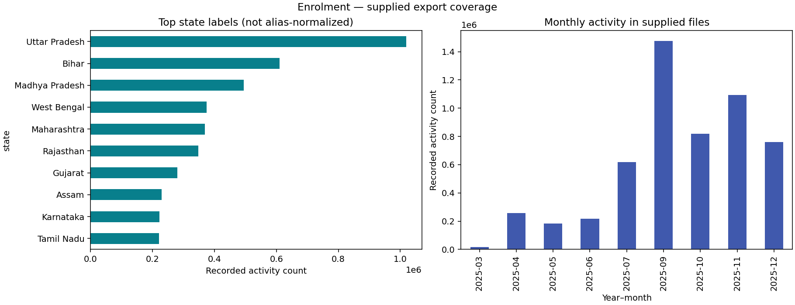
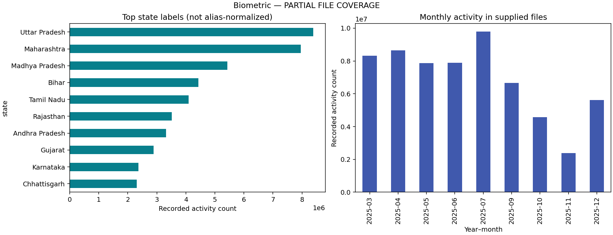
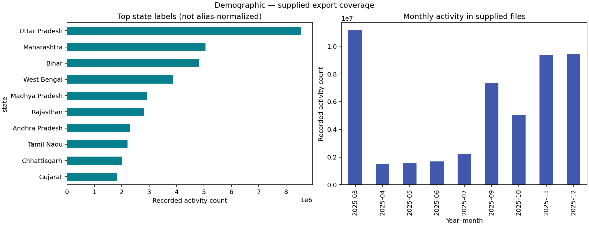

# Aadhaar Enrolment and Update Activity — Data Analysis

Descriptive exploratory data analysis of aggregate Aadhaar enrolment, biometric-update and demographic-update activity, using Python, Pandas and Matplotlib.

## Open and run

[**View the executed notebook**](notebooks/UIDAI_EDA.ipynb) · [**Open in Google Colab**](https://colab.research.google.com/github/AishwaryB-SATI/UIDAI-Data-Analysis/blob/main/notebooks/UIDAI_EDA.ipynb)

No large Excel files are required. The notebook reads the small CSV tables in `reports/`. When opened in Colab it loads those tables directly from this public repository; a local clone uses local files. Run the notebook cells in order. Colab normally includes Pandas and Matplotlib; install `requirements.txt` if they are unavailable.

For local use, clone this repository, install its dependencies, and open `notebooks/UIDAI_EDA.ipynb` in Jupyter or VS Code with a Python notebook kernel:

```bash
git clone https://github.com/AishwaryB-SATI/UIDAI-Data-Analysis.git
cd UIDAI-Data-Analysis
pip install -r requirements.txt
```

## What this project contains

- Monthly activity and observed reporting-day comparisons.
- State-label and state-plus-district comparisons.
- Source age-band totals and charts.
- Previously prepared source-quality metrics and coverage records.
- Executed notebook outputs and aggregate-total reconciliation checks.

## Relationship to data cleaning

Data cleaning will be maintained in a separate repository. Its link will be added when the owner supplies it. This repository performs analysis of **existing aggregate CSVs**, not raw Excel cleaning. These tables are not a cleaned row-level dataset. They support the included comparisons but cannot reconstruct record-level cleaning or every possible joint distribution.

The tables originate from the earlier prepared project package. Exact repeated rows were audited and retained because source record identity was undocumented. Labels were whitespace-normalized but spelling aliases were preserved. The notebook has been executed against the bundled CSVs; no raw Excel sheets were reread during this preparation.

## Coverage and provenance

The owner reports obtaining the source exports from the official UIDAI website. The exact source URL, download date and redistribution terms have not been independently verified. Original exports are not included. `reports/input_manifest.json` records their filenames and schemas.

| Service | Previously recorded source rows | Recorded activity |
|---|---:|---:|
| Enrolment | 1,006,029 | 5,435,702 |
| Biometric updates — partial export | 1,361,108 | 61,776,326 |
| Demographic updates | 2,071,700 | 49,295,187 |

Biometric filenames omit the 1,000,000–1,500,000 portion. Its results describe only the supplied subset. A demographic filename was previously supplied twice; only the retained copy contributed to the prepared results.

## Interpretation limits

- Activity counts are not unique residents, coverage rates or population-normalized measures.
- State labels retain aliases and historical names; rankings are provisional.
- Missing dates are not established zero activity. Reporting coverage varies by month.
- Peaks do not establish recurring seasonality, causality, fraud or staffing shortages.
- Age fields retain source names; definitive boundary metadata remains to be confirmed.
- No predictive, anomaly-detection or fraud-detection model is implemented.

## Charts and reports







See [analysis findings](reports/ANALYSIS.md), [data dictionary](DATA_DICTIONARY.md), and [current validation](reports/analysis_validation.json). Files prefixed `legacy_` describe validation or review performed when the original project package was prepared; they are retained for traceability and do not describe a new Excel run.
